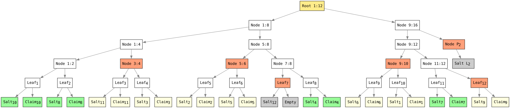

> [!NOTE]
> 🚧 **Work in Progress** - Feedback of any kind is welcome, and contributions are highly appreciated! Feel free to open an issue or submit a pull request.

# Seed-Padded Merkle Tree for Selective Disclosure

A seed-padded Merkle tree is a cryptographic commitment structure. Selective disclosure is achieved by revealing only the targeted leaf nodes data and their corresponding verification paths while keeping undisclosed claims private. It enables a verifier to validate disclosed claims against a single Merkle root. The design prioritizes security, privacy, and computational efficiency.

The tree is binary and balanced, using seed-based padding hashes to handle missing siblings without explicitly constructing or storing all padding nodes. This avoids the space and computation overhead of materializing a fully padded tree. For `n` leaves, root computation takes `O(n)` time and `O(n)` space. The tree depth and the size of an individual verification path are `O(log n)`. Verification paths for multiple disclosed leaves  share common nodes, reducing the total proof size.

## Design Objectives

- Secure Verification: Uses distinct domain-separation prefixes for leaf data, internal nodes, and padding values to distinguish hash inputs by type. Verification recomputes the commitment according to deterministic hashing rules and compares the resulting root with the trusted commitment.
- Privacy: Keeps undisclosed contents private while allowing disclosed claims to be independently verified.
- Unlinkability: Preserves the privacy of the total number of claims and the distribution of undisclosed claims, preventing their disclosure through the selective disclosure process.
- Computational Efficiency: Supports bottom-up root computation and verification path generation with limited intermediate storage. For multiple disclosed elements, shared verification nodes can be reused to reduce proof size and verification overhead.
- Structural Simplicity: Uses deterministic, seed-based padding to handle incomplete node pairs according to a fixed construction rule, avoiding ad hoc tree restructuring.

## Cryptographic Properties

- Deterministic Construction: Defines consistent leaf hashing, internal-node hashing, and padding rules, ensuring reproducible commitments for the same ordered input.
- Efficient Selective Disclosure: Enables verification of disclosed elements using sibling hashes and positional information to reconstruct and verify the Merkle root. Multiple disclosed elements share common verification nodes. 
- Seed-Based Padding: Uses precomputed, seed-based padding hashes to handle non-power-of-two leaf counts consistently while keeping the total number of claims private. To the verifier, padding nodes are indistinguishable from other nodes and leafs.

These properties provide a deterministic and efficient basis for privacy-preserving selective disclosure, enabling verification of disclosed data while keeping undisclosed leaf contents and the total number of claims private, subject to the security of the underlying hash function and the confidentiality of the disclosed data itself.

## Algorithmic Scope 

The selective disclosure process involves three core algorithms, used by the issuer, the disclosing party, and the verifier:

- Root Computation: The issuer computes a Merkle root from the complete, ordered set of leaves. The root serves as a commitment to the dataset.
- verification Path Generation: The disclosing party selects the leaves to reveal and generates their verification paths. These paths provide the additional hash values and positional information needed to verify the disclosed leaves without revealing the remaining leaves.
- Root Reconstruction and Verification: The verifier uses the disclosed leaves and their verification paths to reconstruct the Merkle root. The disclosed data is accepted as consistent with the original commitment if the reconstructed root matches the trusted root.

The algorithms enable the issuer to commit to a dataset, the disclosing party to reveal selected leaves, and the verifier to check them against the original commitment.

## Root Computation

**Input:** An ordered sequence of `n > 1` leaf values.

**Output:** The Merkle root.

1. Hash each leaf as `H(LEAF_PREFIX || salt || data)`, storing the resulting hashes in a single array.
2. Set the current `level size` to `n`.
3. While `level_size > 1` do
   1. Process the current level in adjacent pairs, from left to right.
   2. For each pair, compute the parent hash as `H(NODE_PREFIX || left || right)`.
   3. If the final node has no right sibling, use pre-computed padding hash for the current level as its right sibling.
   4. Store each parent hash in the same array at index `floor(i / 2)`, overwriting the entries of the previous level from left to right, where `i` is the index of the left child.
   5. Update the current `level size` to `ceil(level_size / 2)`.
4. Return the hash at index zero as the Merkle root.

The algorithm reuses a single array to store successive tree levels, avoiding the need to allocate a separate array for each level. It terminates when the current level contains exactly one hash.

> Note: A unique, cryptographically random salt prevents attackers from efficiently guessing the contents of undisclosed leaves by precomputing hashes of likely values and comparing them against published hashes. This protection relies on keeping the salt secret for undisclosed leaves. The issuer and disclosing party can share a secret seed and deterministically derive each leaf's salt from its index, avoiding the need to store or transmit individual salts. When a leaf is disclosed, its salt must be revealed alongside the data so verifiers can recompute its hash.

### Complexity

Let `n` be the number of leaves:

- Time Complexity: `O(n)`. The algorithm hashes each leaf once and computes one parent hash per node pair, including pairs completed using padding. The total number of internal-node hashes is `n - 1`.
- Space Complexity: `O(n)`. The algorithm stores leaf hashes in a single array and reuses that array for successive tree levels, avoiding additional arrays proportional to the number of leaves.
- Tree Depth: `O(log n)`. The number of levels processed grows logarithmically with the number of leaves.

These bounds assume fixed-size hash outputs and constant-time hash operations.

## Implementation Note

The `ceil`, `floor`, and `log2` operations can be implemented using integer arithmetic and bitwise operations, avoiding floating-point calculations and reducing computational overhead.

| Operation                    | Integer/bitwise equivalent                |
| ---------------------------- | ----------------------------------------- |
| `ceil(log2(n))`, for `n > 1` | `bit_length(n - 1)`                       |
| `floor(i / 2)`               | `i >>> 1` in Java                         |
| `ceil(n / 2)`                | `(n + 1) >>> 1` for non-negative integers |

Here, `bit_length(x)` is the number of bits in the binary representation of `x`. e.g. in Java, it can be computed as `32 - Integer.numberOfLeadingZeros(x)` for positive `int` values.

## Actors

### Issuer

- Flattens the dataset into an ordered list of claims.
- Distributes the claims across an array of size `M` using the secret-keyed HMAC slot-distribution algorithm.
- Generates the Seed-Padded Merkle root.
- Signs the Merkle root using the issuer's private key.
- Shares the following with the holder:
  - The signed Merkle root.
  - The issuer's public key.
  - The secret key `K`.
  - The salt seed `S`
  - The dataset.

### Holder

- Flattens the dataset into an ordered list of claims.
- Distributes the claims across an array of size `M` using the same HMAC slot-distribution algorithm and secret key `K`.
- Selects the claims to disclose.
- Generates the Seed-Padded Merkle tree verification path for the selected claims.
- Shares the following with the verifier:
  - The selected claims in their dataset representation.
  - The selected claims salts and assigned slot indices.
  - The corresponding verification path.
  - The issuer's signed Merkle root.

### Verifier

- Flattens the relevant dataset into an ordered list of claims. Let `N` be the number of claims and `M = 2 * ceil( N / 2)`.
- Hashes the disclosed claims and assigns them to their slots using the provided salts and slot indices.
- Reconstructs the Seed-Padded Merkle root from the disclosed claims and verification path.
- Verifies the issuer's signature on the reconstructed Merkle root using the issuer's public key.
- Accepts the disclosed claims only if signature verification.

## Examples

The figure shows a tree with 11 claims, padded to an even number, i.e., 12 leaves. The underlying claims for leaves 1, 2, 8, and 11 are disclosed, while the remaining claims stay private. The verification path include the hash values for nodes 3:4, 5:6, 9:10 and P2 (depth-based padding level 2), as well as leaves 7 and 12, allowing the verifier to reconstruct and verify the root. 
